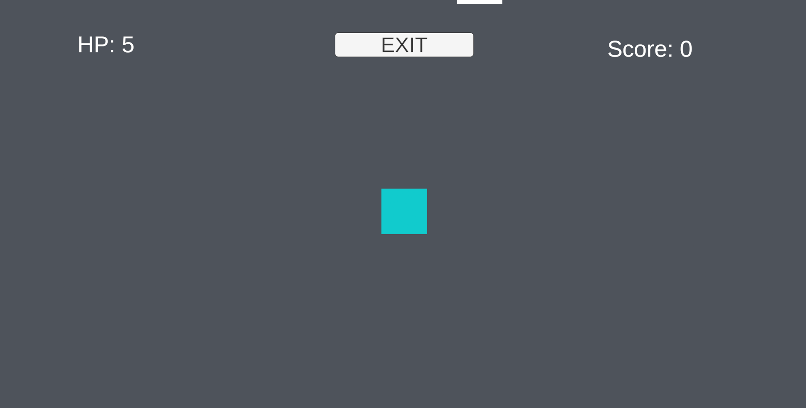
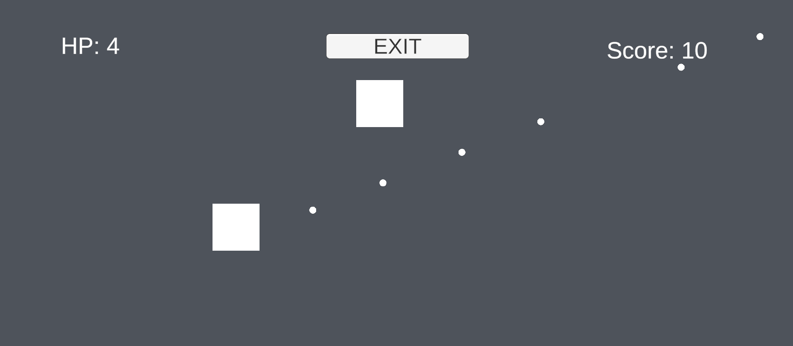
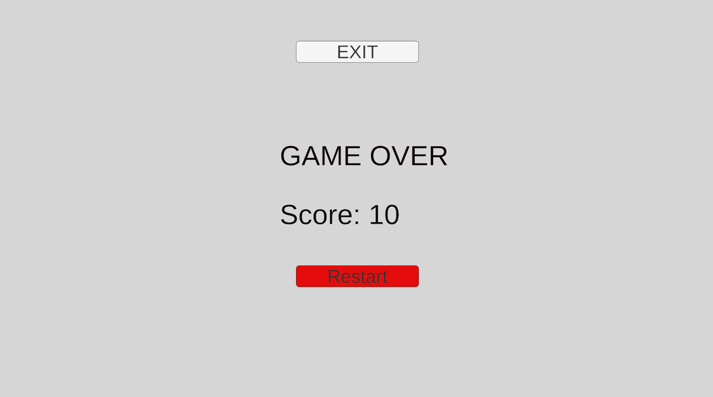

# 2D Combat Prototype

A small Unity 2D gameplay prototype focused on real-time combat and reusable gameplay systems.

## Screenshots

### Gameplay

### Combat

### Game Over

## Features

- Player movement using Unity's New Input System
- Mouse-based aiming and projectile shooting
- Enemy pursuit and contact damage
- Reusable health and damage system
- Score-based progression
- Increasing enemy spawn rate as the score increases
- Game-over and restart flow
- Start and quit controls

## Tech

- Unity 6
- C#
- Unity New Input System
- TextMeshPro
- Git / GitHub

## Controls

- WASD — Move
- Left Mouse Button — Shoot
- Restart / Quit — Game Over screen

## Project

This is a small gameplay prototype rather than a complete commercial game. The project was built to practice implementing core gameplay systems and connecting them into a playable loop.